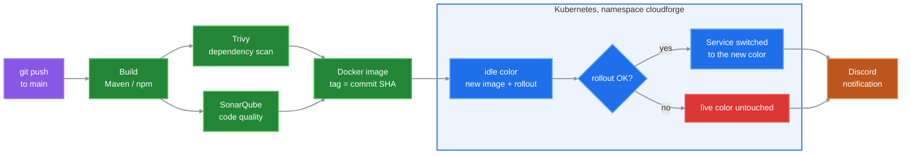

# CloudForge: CI/CD and Kubernetes for a microservices app


The delivery platform around a Spring Boot microservices e-commerce application: one CI/CD pipeline per service, security and quality scans, images tagged with the commit SHA, **blue/green deployments** on Kubernetes, and a Prometheus, Grafana, Loki and Alertmanager stack.

> The application code comes from the [Spring Boot 3 Microservices course by Programming Techie](https://github.com/SaiUpadhyayula/spring-boot-3-microservices-course). The pipelines, Kubernetes manifests, blue/green strategy and observability setup are my work.

## Delivery pipeline



Each service has its own workflow in [.github/workflows](.github/workflows/), triggered only when that service's folder changes:

| Stage | What runs | Where |
|---|---|---|
| Build | `mvn package` (Java) or the Angular production build | GitHub-hosted runner |
| Dependency scan | `trivy fs`, report kept as an artifact | self-hosted runner |
| Code quality | SonarQube scan | self-hosted runner |
| Image | Docker build, pushed as `:<commit SHA>` and `:latest` (push to `main` only) | self-hosted runner |
| Image scan (frontend) | `trivy image`, HIGH and CRITICAL only | self-hosted runner |
| Deploy | blue/green (api-gateway: rolling update) | self-hosted runner with `kubectl` access |
| Notify | result and run link sent to Discord | GitHub-hosted runner |

## Blue/green deployments

Each of `product-service`, `inventory-service`, `order-service` and `frontend` runs as **two Deployments**, `<service>-blue` and `<service>-green`. The Service sends traffic to one of them through a label in its selector (`color` for product-service, `version` for the others).

On every push to `main`, the deploy job:

1. Creates both Deployments and the Service if they do not exist yet (first deploy only).
2. Reads which color is live from the Service selector, and picks the other one.
3. Sets the new image (`:<commit SHA>`) on the idle color and waits for its rollout.
4. Switches the Service selector to that color. If the rollout fails, the job stops here and the live color keeps serving.

The previous version stays deployed on the other color, so a rollback is one command:

```bash
kubectl patch service product-service -n cloudforge \
  -p '{"spec":{"selector":{"app":"product-service","color":"blue"}}}'
```

## Application


An API gateway (Spring Cloud Gateway with Resilience4j) in front of four services, secured with Keycloak:

| Service | Storage | Talks to |
|---|---|---|
| product-service | MongoDB | |
| order-service | MySQL | inventory-service (sync), notification-service (Kafka) |
| inventory-service | MySQL | |
| notification-service | | consumes order events from Kafka |
| frontend | | Angular UI through the API gateway |

## Repository layout

```text
.github/workflows/       one pipeline per service
k8s/                     manifests deployed by the pipelines (namespace cloudforge)
k8s-prod/                second environment, applied by hand (namespace cloudforge-prod):
                         Keycloak and its database, Ingress, LoadBalancer frontend
k8s-monitoring/          Prometheus, Alertmanager and alert rules, Grafana, Loki (namespace monitoring)
docker-compose.yml       local infrastructure: databases, Kafka, Keycloak, Prometheus, Grafana, Loki, Tempo
docker/                  configuration files for docker-compose
<service>/               application code and Dockerfile of each service
```

## Secrets

| Secret | Used by | Stored in |
|---|---|---|
| `DOCKER_PASSWORD` | image push | GitHub Actions secrets |
| `SONAR_TOKEN` | SonarQube scan | GitHub Actions secrets |
| `DISCORD_WEBHOOK` | notifications | GitHub Actions secrets |
| `SONAR_TOKEN`, `DISCORD_WEBHOOK` | notification-service pipeline | HashiCorp Vault, read with GitHub's OIDC token (JWT auth), so no Vault credential is stored in GitHub |

## Run it

**Pipelines** need a self-hosted runner with Docker, Trivy and `kubectl` access to the cluster, a SonarQube server, the `cloudforge` namespace, and the secrets above.

**Monitoring:**

```bash
kubectl create namespace monitoring
kubectl apply -f k8s-monitoring/
```

**Local infrastructure** for development:

```bash
docker compose up -d
```

## Limitations

- Unit tests run only for product-service. The other Java builds skip them, and the frontend tests are not run in CI yet.
- The frontend image runs the Angular development server (`ng serve`), not a static build behind nginx.
- `k8s-prod/` is not deployed by the pipelines.
